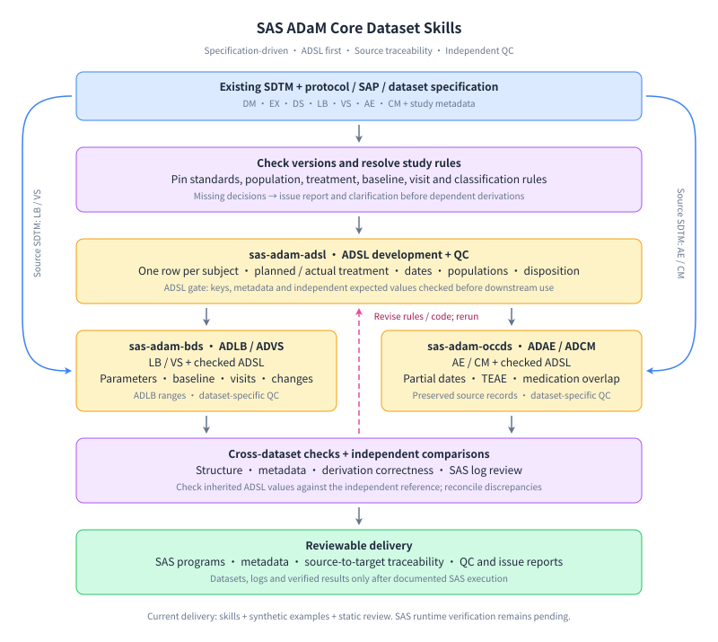

# SAS ADaM Core Dataset Skills

This PharmaSUG 2027 project develops specification-driven agent skills for
**ADaM core dataset development in SAS 9.4**, with ADSL as the first priority.
The initial scope is ADSL, BDS ADLB/ADVS and OCCDS ADAE/ADCM. “Core” denotes our
selected project scope, not a fixed set of datasets required by CDISC for every study.

The intended users are CRO and pharma statistical programmers developing and
reviewing analysis datasets. Existing SDTM and approved study documents are
inputs; the deliverables are readable SAS programs, dataset metadata, derivation
traceability and QC evidence.

## Aim and scope

| Priority | Structure / datasets | Initial capabilities |
| --- | --- | --- |
| First | ADSL | Subject completeness, demographics, planned/actual treatment, exposure dates, populations and disposition |
| Next | BDS: ADLB, ADVS | Parameter mapping, analysis dates/visits, baseline selection, BASE/CHG/PCHG, analysis flags and laboratory normal ranges |
| Next | OCCDS: ADAE, ADCM | Occurrence records, source dates, date uncertainty, treatment-emergent AE and prior/concomitant medication classifications |

ADSL provides checked subject-level context to downstream datasets. ADLB/ADVS
also require LB/VS; ADAE/ADCM also require AE/CM. Source-specific derivations
cannot be constructed from ADSL alone.

Version 1 targets general Base SAS 9.4 without sponsor-private macros. Standards
retrieval and specification review support dataset development; QC is integrated
into each dataset skill. Raw-to-SDTM generation, TLF production, ADTTE, tumor
response, complex multi-period designs and full submission packaging are outside
this release.

## Skills and usage

| Skill | Role |
| --- | --- |
| [pharma-skills-development](.agents/skills/pharma-skills-development/SKILL.md) | Project roadmap, shared conventions, standards evidence and routing |
| [sas-adam-adsl](.agents/skills/sas-adam-adsl/SKILL.md) | Develop and independently check subject-level ADSL |
| [sas-adam-bds](.agents/skills/sas-adam-bds/SKILL.md) | Develop ADLB/ADVS using checked ADSL and source findings |
| [sas-adam-occds](.agents/skills/sas-adam-occds/SKILL.md) | Develop ADAE/ADCM using checked ADSL and source occurrences |

The three dataset skills can be invoked directly. They share references in the
project skill, so distribute the repository skill bundle together. Study-specific
rules and unresolved decisions can be recorded in the
[study-context template](.agents/skills/pharma-skills-development/assets/study-context.yaml).
This template is a decision checklist, not a SAS configuration parser.

```text
Use $sas-adam-adsl to develop ADSL from the supplied DM, EX and DS,
following this study's approved specification. Identify missing decisions
and provide SAS code, traceability, and independent QC expectations.
```

```text
Use $sas-adam-bds to develop ADLB and ADVS from LB, VS and checked ADSL.
Use the supplied parameter, baseline and visit rules; preserve source links.
```

```text
Use $sas-adam-occds to develop ADAE and ADCM from AE, CM and checked ADSL.
Apply the specified TEAE and medication interval rules and expose uncertainty.
```

## Workflow



The workflow prioritizes ADSL before its downstream consumers. QC checks
structure, metadata, derivations and logs separately. Downstream agreement with
ADSL is supplemented with source-based expectations to detect consistently
propagated errors. Discrepancies trigger rule/code review and rerunning checks.

Diagram follows the [svg-diagram skill](https://github.com/bybit-exchange/svg-diagram).

## Worked SAS example

The [12-subject example](examples/adam-core/README.md) includes synthetic
DM/EX/DS/LB/VS/AE/CM, five production programs, a dependency-ordered runner,
hand-authored expected values, QC comparisons, metadata checks and negative cases.
The [specification](examples/adam-core/specification.md) explicitly defines its
synthetic rules. It is a bounded teaching example, not a general validated
benchmark pipeline.

From the repository root, in an environment with SAS installed:

```sh
sas -sysin examples/adam-core/run_all.sas
```

### Existing skills and our contribution

Public-source review date: **2026-10-19**. The nearest related work is
[R Consortium Pharma Skills](https://github.com/RConsortium/pharma-skills):

| Related skill | Existing capability | Relationship to this project |
| --- | --- | --- |
| [admiral family](https://github.com/RConsortium/pharma-skills/blob/main/admiral/SKILL.md), including ADSL, BDS and ADAE | R ADaM derivations through `{admiral}`, shared conventions and dataset-specific guidance | Demonstrates that ADaM category routing and derivation skills already exist; our execution examples target SAS |
| [statistical-reviewer](https://github.com/RConsortium/pharma-skills/blob/main/statistical-reviewer/SKILL.md) | Reviews results and traces TLF/ADaM/SDTM against study documents | Related QC work; our scope is dataset construction with a small independent fixture oracle |
| [sdtm-oak](https://github.com/RConsortium/pharma-skills/blob/main/sdtm-oak/SKILL.md) | R raw-to-SDTM mapping using `{sdtm.oak}` | Upstream work; our first release starts with existing SDTM |

Our proposed contribution is a **SAS-focused, ADSL-first skill bundle connecting
specifications, reviewable SAS derivations, cross-dataset consistency and
independent QC examples** across ADSL, ADLB, ADVS, ADAE and ADCM. This includes
explicit treatment of SAS execution/log evidence and unresolved analysis rules.

Among the public skills reviewed in this search, we have not confirmed a
SAS implementation with the same coverage and deliverable combination. This is
a scoped observation, not proof that no such project exists or a claim of
global priority. Category-based skills, ADaM derivation and independent review
are established ideas; the contribution to evaluate is this specific SAS
workflow and its demonstrated behavior.

We adopt useful design patterns—focused dataset references, explicit inputs,
study-decision annotations and traceable QC—without mechanically translating
R package calls or importing their defaults as study rules. No third-party
skill is installed or required by the examples.

## Current status and verification

Delivered: four skills with shared guidance, SAS examples, explicit specifications,
independent reference values, QC/negative-case programs and this workflow diagram.

Checked locally: skill structure, YAML and links, source/specification review,
fixture counts and reference arithmetic, Python log-screen tests and SVG rendering.
These checks do **not** execute SAS or establish full CDISC conformance.

**SAS execution validation remains pending.** No SAS executable was available
in the authoring environment. Compilation, actual log review, PROC COMPARE
results and negative-case detection must be verified in SAS 9.4 before claiming
runtime correctness. See the [validation record](examples/adam-core/validation.md).
